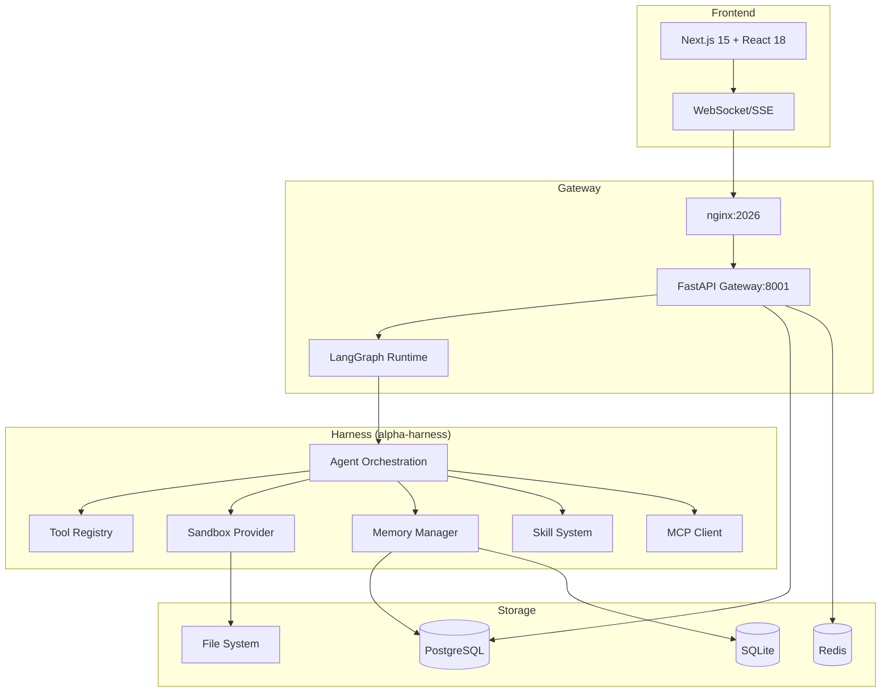

# Alpha

> **Alpha** — An autonomous AI agent framework with sandboxed execution, persistent memory, subagent delegation, and extensible tooling. Built for autonomous operations at scale.

[](https://github.com/itsPremkumar/alpha/stargazers)
[](https://github.com/itsPremkumar/alpha/network/members)
[](https://github.com/itsPremkumar/alpha/issues)
[](https://github.com/itsPremkumar/alpha/pulls)
[](LICENSE)
[](https://discord.gg/alpha)
[](https://hub.docker.com/r/premkumar/alpha)

[](https://python.org)
[](https://nodejs.org)
[](https://typescriptlang.org)
[](https://react.dev)
[](https://fastapi.tiangolo.com)
[](https://langchain.com)

[](https://github.com/itsPremkumar/alpha/actions/workflows/ci.yml)
[](https://codecov.io/gh/itsPremkumar/alpha)
[](https://github.com/itsPremkumar/alpha/actions/workflows/quality.yml)
[](https://github.com/itsPremkumar/alpha/security)
[](https://github.com/itsPremkumar/alpha/network/dependencies)

---

## 🎯 What is Alpha?

**Alpha** is a **LangGraph-based AI super-agent system** — a backend "super agent" with sandboxed execution, persistent memory, subagent delegation, and extensible tooling (built-in, MCP, community), all per-thread isolated; a Next.js chat frontend; and IM bridges (Feishu, Slack, Telegram, Discord, DingTalk) into the same agent through the Gateway.

Alpha enables **autonomous AI operations at scale** — from single-agent task execution to multi-agent swarms, from simple chat to mission-critical autonomous operations with full observability, governance, and human-in-the-loop controls.

---

## ✨ Key Capabilities

| Capability | Description |
|------------|-------------|
| 🤖 **Super Agent** | LangGraph-based orchestrator with tool calling, model routing, and autonomous execution |
| 🏖️ **Sandboxed Execution** | Isolated environments (Docker, AIO, E2B, local) per thread with file I/O, network, and process isolation |
| 🧠 **Persistent Memory** | DeerMem + cognitive memory with semantic search, summarization, and cross-thread recall |
| 👥 **Subagent Delegation** | Spawn specialized agents (`/subagent spawn`), manage swarms (`/swarm`), delegate with acceptance criteria |
| ⚔️ **Arena Tournaments** | N sub-agents solve one task with different strategy cards, then attack/defend/judge in a durable single-elimination bracket until one solution survives ([docs/ARENA.md](docs/ARENA.md)) |
| 🔌 **Extensible Tooling** | 138 built-in tools + MCP servers + custom skills + community extensions |
| 💾 **Per-Thread Isolation** | Every conversation gets its own sandbox, memory, and tool namespace |
| 🌐 **IM Bridges** | Native Feishu, Slack, Telegram, Discord, DingTalk connectors via unified Gateway |
| 📊 **Observability** | Real-time SSE streams, run traces, token usage, cost tracking, delivery receipts |
| 🛡️ **Governance** | Tool risk policies, approval gates, capability ceilings, emergency stop |
| 🔄 **Durable Runtime** | Crash recovery, network partitions, graceful shutdown, session persistence |

---

## 🏗️ Architecture



---

## 🚀 Quick Start

### Prerequisites
- **Docker** + **Docker Compose v2.24+**
- **Node.js 22+**, **pnpm 11+**
- **Python 3.12+**, **uv**
- **nginx** (project-local binary included)

### One-Command Start

```bash
# Clone and configure
git clone https://github.com/itsPremkumar/alpha.git
cd alpha
cp config.example.yaml config.yaml
# Edit config.yaml with your API keys

# Start everything (Docker)
make docker-start

# Or local development
make dev
```

### Access Points
| Service | URL |
|---------|-----|
| **Web UI** | http://localhost:2026 |
| **API Gateway** | http://localhost:8001 |
| **LangGraph API** | http://localhost:8001/api/langgraph/* |
| **API Docs** | http://localhost:8001/docs |
| **Health Check** | http://localhost:8001/health |

---

## 📖 Documentation

| Document | Description |
|----------|-------------|
| [Architecture](docs/architecture/README.md) | System architecture, data flows, component interactions |
| [Configuration](docs/CONFIGURATION.md) | Complete configuration reference |
| [API Reference](docs/api/README.md) | Complete REST API documentation |
| [Deployment](docs/DEPLOYMENT.md) | Production deployment guide |
| [Development](docs/DEVELOPMENT.md) | Local development setup, testing, debugging |
| [Security](docs/SECURITY.md) | Security model, sandbox, permissions |
| [MCP Integration](docs/MCP_SERVER.md) | Model Context Protocol integration |
| [File Upload](docs/FILE_UPLOAD.md) | File upload handling |
| [Summarization](docs/summarization.md) | Conversation summarization |
| [Plan Mode](docs/plan_mode_usage.md) | TodoList middleware for complex tasks |

---

## 🛠️ Development

### Backend
```bash
cd backend
make install          # Install dependencies
make dev              # Start Gateway with hot-reload
make test             # Run offline tests
make test-blocking-io # Strict blocking I/O tests
make lint             # Ruff lint
make format           # Ruff format
```

### Frontend
```bash
cd frontend
pnpm install          # Install dependencies
pnpm dev              # Next.js dev server (port 3000)
pnpm verify           # Typecheck + tests
pnpm build            # Production build
pnpm start            # Production server
```

### Full Stack
```bash
make dev              # All services via Docker (recommended)
make docker-start     # Production-like Docker stack
make docker-stop      # Stop all services
make docker-logs      # View logs
```

---

## 🤝 Contributing

We welcome contributions! Please see our [Contributing Guide](CONTRIBUTING.md) for details.

### Quick Contribution Checklist
- [ ] Read [CONTRIBUTING.md](CONTRIBUTING.md)
- [ ] Sign [CLA](https://cla.itsPremkumar.com) (if required)
- [ ] Run `make format` / `pnpm format:write`
- [ ] Run tests: `make test` / `pnpm verify`
- [ ] Update documentation if needed
- [ ] Add tests for new features

### Good First Issues
Look for issues labeled [`good first issue`](https://github.com/itsPremkumar/alpha/labels/good%20first%20issue) — perfect for new contributors!

---

## 📜 License

Alpha is licensed under the **MIT License** — see [LICENSE](LICENSE) for details.

---

## 🙏 Acknowledgments

- **LangGraph** — Agent orchestration framework
- **FastAPI** — High-performance API framework
- **Next.js** — React framework for production
- **DeerMem** — Persistent memory layer
- **LangChain** — LLM orchestration primitives
- **All Contributors** — See [CONTRIBUTORS.md](CONTRIBUTORS.md)

---

## 🔗 Links

- **Website**: https://alpha.itsPremkumar.com
- **Documentation**: https://docs.alpha.itsPremkumar.com
- **Discord**: https://discord.gg/alpha
- **Twitter**: https://twitter.com/alpha_ai
- **Blog**: https://blog.itsPremkumar.com/alpha

---

<div align="center">

**Made with ❤️ by [Prem Kumar](https://github.com/itsPremkumar) and contributors**

[⭐ Star us on GitHub](https://github.com/itsPremkumar/alpha) • [🐛 Report Bug](https://github.com/itsPremkumar/alpha/issues/new?template=bug_report.md) • [💡 Request Feature](https://github.com/itsPremkumar/alpha/issues/new?template=feature_request.md)

</div>