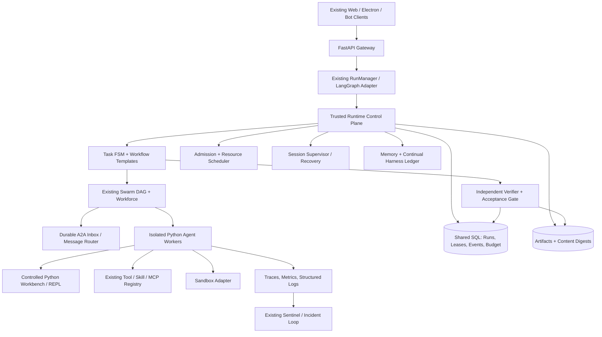
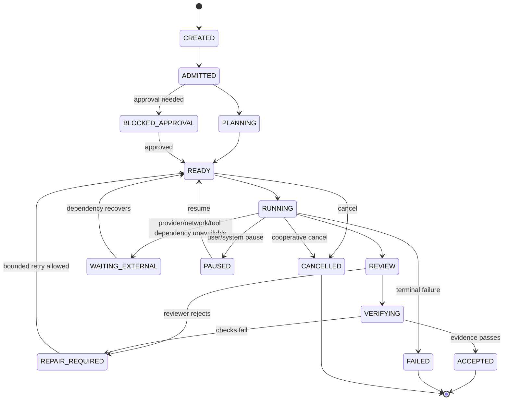
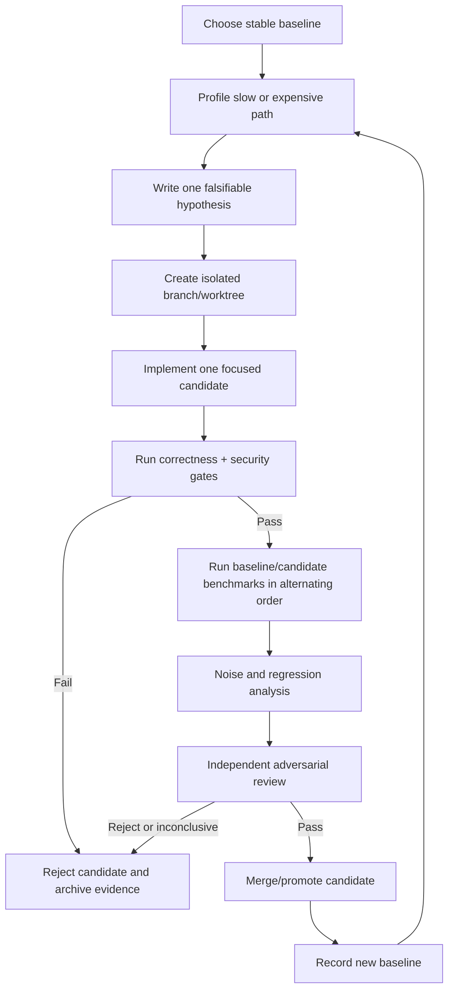

# Alpha: Prime Agent–Inspired Advanced Python Implementation Plan

**Document type:** Architecture and implementation blueprint  
**Target project:** [itsPremkumar/alpha](https://github.com/itsPremkumar/alpha)  
**Research date:** 10 October 2026  
**Implementation constraint:** Keep Alpha's agent runtime, orchestration, workers, and backend services in Python. Do not port the backend to Rust. Keep the existing TypeScript/Next.js and Electron presentation layers unless an explicitly scoped UI change is needed.  
**Primary inspiration:** [Prime Agent](https://github.com/PrimeIntellect-ai/prime-agent), especially its Recursive Language Model (RLM) programming model, Continual Harness, persistent subagents, agent-to-agent messaging, bounded autonomous continuation, verification-driven task state machines, and performance hillclimbing.

> **Important scope rule:** This is a plan, not an assertion that every item is missing from Alpha. Alpha's public README and docs already describe substantial implementations of LangGraph workflows, APEX Autopilot, a Swarm v2 DAG runtime, worker leases, persistent memory, skills/MCP, sandboxing, Sentinel, budgets, an acceptance gate, and restart recovery. This plan extends and hardens those systems rather than introducing parallel copies. Before coding, inspect the current implementation and tests to classify every item as **implemented and enforced**, **partially implemented**, **documented but not wired**, or **missing**.

---

## 1. Executive direction

Prime Agent's most transferable insight is not “spawn thousands of agents.” It is the engineering discipline around long-running agent work:

1. Make task execution **programmatic and composable**, not trapped inside one giant prompt.
2. Preserve useful state across turns, context compaction, detached UI sessions, and process restarts.
3. Allow agents to communicate directly when that is more efficient than routing every message through a parent.
4. Represent tasks and workflows as explicit state machines with clear retry, timeout, cancellation, budget, and verification semantics.
5. Separate **planning, implementation, adversarial review, and independent verification**.
6. Require machine-checkable evidence before claiming completion.
7. Treat self-improvement as small, versioned, reversible, evidence-backed edits—not unrestricted self-modification.
8. Optimize against repeatable benchmarks while enforcing correctness gates.
9. Measure actual provider, tool, task, and resource usage; do not invent or silently approximate success metrics.
10. Use process isolation for failure containment and a real sandbox for security. These are different protections.

For Alpha, the recommended outcome is a **Python-native Persistent Agent Runtime and Verified Work Factory** integrated with existing subsystems. The runtime should make an Alpha agent able to:

- retain useful working context without keeping every detail in the LLM prompt;
- inspect and transform files/data through controlled Python-backed operations;
- delegate recursive, bounded sub-tasks to persistent specialist agents;
- discover and message active peers using durable typed messages;
- continue a user-approved goal after a UI disconnect or recoverable restart;
- resume only from a checkpoint proven safe to resume;
- generate a traceable plan and acceptance criteria;
- run changes in an isolated worktree/sandbox;
- return a completed artifact plus independent evidence;
- learn reusable workflow improvements from successful and failed attempts;
- report exactly what it did, did not do, could not verify, and why.

### Design principles

- **Python-only agent core:** Use Python 3.12+ and the existing async FastAPI/LangGraph stack. No backend rewrite is required to adopt Prime's architecture.
- **Reuse first:** Build on Alpha's current RunManager, LangGraph checkpoints, swarm DAG, APEX goals/acceptance, bot workforce, memory, skill/MCP registry, sandbox adapters, audit journal, and Sentinel. Add new packages only where an auditable gap remains.
- **Durable before autonomous:** A long-running mode is not ready until restart recovery, cancellation, budget enforcement, and evidence gates pass fault-injection tests.
- **Evidence before green status:** `run completed`, `tests passed`, and `goal accepted` are separate facts.
- **Bounded by default:** Every spawned child, recursive branch, model call, command, and loop has a deadline and resource ceiling.
- **Never treat a prompt as a security boundary:** Model-generated Python and shell commands execute with the permissions of their execution environment. Use containers or another real isolation boundary for untrusted code.
- **Small reversible changes:** Keep all self-improvement patches versioned, reviewed, eval-tested, and rollbackable.

---

## 2. Research basis: what to transfer from Prime Agent

### 2.1 Recursive Language Model (RLM) programming model

Prime Agent's published RLM documentation describes a persistent Python control environment used to inspect/search/transform data, run commands, invoke Python-backed skills, and spawn focused child agents. The host—not the Python kernel—owns provider calls, session persistence, child lifecycle, scheduling, and safety policy. This division is important: a Python REPL is a powerful programming interface, but it is not automatically a safe sandbox.

**Transfer to Alpha:** expose a small, consistent Python-backed runtime API for model-directed computation and orchestration while keeping authoritative state transitions in Alpha's trusted host services. Model code should request actions through validated host functions instead of directly editing mission records, bypassing approvals, or mutating run status.

### 2.2 Continual Harness

Prime Agent describes a persisted ledger of supplemental prompt notes, memories, reusable skill descriptions, subagent specifications, and refinement events. Its refinement process produces small Create/Update/Delete operations based on observed trajectories, records changes, and supports rollback. The base system prompt is not rewritten.

**Transfer to Alpha:** turn Alpha's existing memory/skill/agent-template ecosystem into a measured learning lifecycle: observe a repeated pattern, propose a narrow change, evaluate it, approve it according to risk, version it, and roll it back if it reduces performance or violates safety.

### 2.3 Persistent workers and goals

Prime Agent's daemon-backed sessions survive UI detachment; session transcripts and artifacts remain persisted; goals are durable objectives; autonomous mode controls continuation with finite turn/token/time limits and optional quality gates. These are separate from one another: a saved goal does not automatically mean the agent should run forever, and reaching a continuation limit does not mean the goal succeeded.

**Transfer to Alpha:** extend and test the existing durable runtime / APEX / scheduled-run systems. Do not create a second execution stack. The UI must be allowed to disconnect without accidentally cancelling a durable goal, but explicit stop/cancel must have reliable semantics.

### 2.4 Direct agent-to-agent communication

A tree of agents is good for ownership and supervision, but routing every message through the root wastes context and creates a bottleneck. Direct messaging enables a specialist that already inspected a subsystem to answer a later request without repeating the full investigation.

**Transfer to Alpha:** keep hierarchy for accountability, but add routed peer messages on top of the existing workforce/A2A services. Use selective delivery, bounded inboxes, context references, acknowledgements, and durable event history rather than an all-to-all message flood.

### 2.5 Verification-driven task state machines

Prime's rewrite report describes one root orchestrator and separate Planner, Implementer, Reviewer, and Verifier roles. A task is retried after a failed review or verification and merged only after both gates pass. A fresh execution environment is used for verification. This reduces the tendency of a coding model to approve its own work.

**Transfer to Alpha:** create reusable, configurable workflow templates for code changes, research reports, data tasks, and operations work. Define the acceptance contract before implementation. Never let the implementation agent alone declare its own result verified.

### 2.6 Parity testing and performance hillclimbing

Prime's migration used several forms of objective parity checks: scripted UI behavior, transcripts/provider requests, protocol contracts, and a component-by-component feature inventory. Its performance loop profiled a baseline, proposed focused hypotheses, benchmarked baseline and candidate under comparable conditions, checked correctness with separate reviewers, and only then merged changes.

**Transfer to Alpha:** establish a benchmark/evaluation harness before asking agents to refactor Alpha itself. Build real regression fixtures, record raw results, compare changes against a known baseline, and preserve all experiment records.

### 2.7 Infrastructure lessons

Prime's large experiment depended on a fleet of hosted sandboxes and model inference; its resource scale is not a realistic free-laptop target. The transferable parts are orchestration and verification—not the number of agents or the hosted infrastructure bill. Alpha can start with a small local or Docker-backed worker pool and add concurrency only when measurements justify it.

---

## 3. Alpha baseline and gap-aware implementation policy

The public Alpha repository currently describes a Python 3.12+ FastAPI gateway, LangGraph runtime, SQLite/PostgreSQL persistence, vector memory, sandbox adapters, Swarm v2 DAG, APEX Autopilot, workforce/bot features, skills and MCP, budget controls, acceptance evidence, and Sentinel-related recovery. The repository is the authoritative starting point, but README claims are not proof that every path is wired in every execution mode.

### 3.1 Known overlap: reuse, do not duplicate

| Prime-inspired capability | Alpha public docs already describe | What this plan should do |
|---|---|---|
| Graph/task decomposition | LangGraph, DAG, dependency checks, multiple swarm topologies | Inspect lifecycle invariants and fill execution/recovery gaps; avoid a second graph engine. |
| Persistent long-running goals | APEX sessions/goals, RunManager and durable runtime | Unify continuation policy, checkpoint safety, evidence collection, and restart drills. |
| A2A and agent workforce | Bots, private inboxes, DMs, group rooms, A2A, project membership | Verify semantics; add peer discovery/context references/deduplication only where absent. |
| Persistent memory | Layered memory, provenance and retrieval | Add evidence-based harness refinement, versioning, expiry and evaluation. |
| Skills/MCP | Public skills and MCP/extension surfaces | Add Python-backed typed skill contracts, provenance/scoped permissions and staged installation if missing. |
| Autonomy budgets | APEX token/task/replan limits and swarm limits | Close measured-cost, CPU/RAM, global budget and in-flight overrun gaps. |
| Acceptance | Explicit APEX acceptance gate and evidence records | Add automatic test/artifact/HTTP evidence collectors and wire them to run completion. |
| Sandboxing | Local subprocess, Docker, optional provisioner/Kubernetes | Verify per-session isolation and security. Keep process isolation distinct from sandbox security. |
| Monitoring/repair | Sentinel, telemetry/audit, durable runtime documentation | Wire a single event model end to end; add replayable incident records and recovery drills. |
| Restart recovery | Durable run state, leases, watchdog documentation | Test installed Windows launcher and actual backend worker recovery rather than rely on unit tests alone. |
| Coding pipeline | Existing code agent/repair systems; public README identifies review/merge as a gap | Prioritize plan → worktree → implement → adversarial review → tests → merge/rollback factory. |

### 3.2 Publicly documented gaps worth targeting early

The following items are explicitly qualified in the public repository documentation at the research date; confirm whether each still holds before implementation:

1. **Swarm persistence across multiple Gateway workers:** current docs say the local atomic JSON/JSONL state adapter is only restart-recoverable for one Gateway process. Multi-worker execution needs a shared SQL lease repository before claiming cross-process exactly-once behavior.
2. **APEX acceptance automation:** current docs describe evidence submission but say automatic test/artifact/HTTP evidence collectors are not yet fully wired into an automatic execution path.
3. **Resource and money accounting:** APEX docs note missing per-session CPU/RAM and estimated cost projections; tokens are not equivalent to currency when provider pricing is unknown.
4. **Recovery wiring:** durable-runtime docs note the Python `ProcessSupervisor` is not wired into the Windows launcher, which uses a separate watchdog chain. A real reboot/crash recovery drill is still needed to prove installed behavior.
5. **End-to-end code delivery:** the README calls review-and-merge workflows an area where Alpha is less complete than a focused software-engineering agent.
6. **Evidence completeness:** a completed RunManager execution is not automatically acceptance; tests must make it impossible for the UI or LLM summary to silently convert `unverified` into `passed`.
7. **Capability-manifest/documentation drift:** the public README shows different generated capability counts in different sections (for example, 136 vs. 137 tools and 44 vs. 46 middleware layers / 10 vs. 13 supervisor loops). Treat the generated manifest and live registries as the source of truth, and make documentation regeneration/checking part of CI rather than hand-maintaining the counts.

These are particularly valuable because they connect Prime's lessons to specific, documented Alpha work—not a generic wishlist.

### 3.3 First task before coding: generate a truthful capability audit

Create `docs/PRIME_INSPIRED_CAPABILITY_AUDIT.md` with one row per feature below and these states:

- `VERIFIED_PRESENT`: source implementation + passing tests + runtime wiring found.
- `PARTIAL`: code exists but one or more required invariants, integrations, or failure cases are absent.
- `DOCUMENTED_ONLY`: documentation exists but wired execution path is not proven.
- `MISSING`: no implementation found.
- `NOT_APPLICABLE`: out of scope for Python-only backend.

Every `VERIFIED_PRESENT` result must link to a Python symbol and at least one test. “README says it exists” is not sufficient evidence. Do not proceed to write a second implementation of a verified capability.

---

## 4. Target architecture

### 4.1 Logical components



The Python workbench is not the trusted control plane. It can compute and request actions, but it cannot bypass the host's authorization, budgets, persistence rules, or approval decisions.

### 4.2 Runtime process boundaries

Recommended deployment boundaries:

- **Gateway process:** HTTP/authentication, API schemas, orchestration admission, serving events and health endpoints.
- **Supervisor:** owns worker lifecycle, leases, heartbeats, restart decisions and reconciliation. May be a separate process on Windows; actual install chain must be tested.
- **Session worker process:** owns one durable agent session or a small explicitly bounded pool. A worker crash should not terminate other sessions.
- **Sandbox process/container:** executes untrusted project code, shell commands, package installation and tests. A process worker is for failure isolation; a sandbox is for security isolation.
- **Verifier process/container:** performs independent checks against a committed snapshot or clean worktree with limited write capability.
- **Telemetry/incident loop:** consumes the canonical event stream, detects stalled/failed behaviors, and proposes bounded fixes. It must not patch its own safety gate without approval.

### 4.3 Module boundaries in Python

Extend existing packages instead of creating a competing tree. Exact path names below are proposals; map them to the current repository layout during the capability audit.

```text
backend/packages/harness/alpha/
  runtime/
    sessions/           # existing: durable session/run lifecycle
    workers/            # existing or new: process worker + supervisor adapters
    admission/          # new/strengthen: concurrency/resource admission
    events/             # shared event contracts and replay cursor
  orchestration/
    fsm/                # reusable finite-state workflow templates
    dependency/         # DAG validation and readiness queries
    dispatch/           # bounded agent placement and fairness
  rlm/
    api.py              # exposed model-facing runtime facade
    workspace.py        # controlled variable/artifact registry
    compaction.py       # summary + artifact pointers
    child_handles.py    # child admission, query, collect, close
    host_bridge.py      # validated typed requests to trusted services
  workforce/
    messaging/          # existing A2A/inbox; harden durability and contracts
    presence.py         # agent capability/availability registry
  continual_harness/
    ledger.py           # versioned supplemental memories/prompts/skills/roles
    refinement.py       # proposed change generation and review
    evaluation.py       # tests before promotion
    rollback.py         # restore prior version
  verification/
    acceptance.py       # trusted acceptance/evidence policies
    collectors/         # pytest, artifact, API, CLI, typecheck collectors
    differential.py     # compare baseline and candidate behavior
  optimization/
    benchmarks.py       # deterministic workload registry
    profiler.py         # CPU/memory/latency profile adapters
    experiments.py      # hypothesis, candidate, results, promotion state
  observability/
    events.py           # canonical event schemas
    traces.py           # trace/span correlation
    metrics.py          # runtime counters/histograms
  policies/
    budgets.py           # authoritative limits and accounting
    permissions.py       # tool/skill/path/network scopes
```

**Boundary rules:**

- Low-level `contracts` and domain types do not import Gateway routers, UI adapters, or high-level workflow packages.
- Domain packages should not call each other's private internals. Use typed service interfaces or events.
- Only the trusted control plane mutates run status, leases, budget ledgers, approval state, and acceptance verdicts.
- Only the event writer assigns sequence numbers to durable events.
- All tools capable of side effects declare permission and risk metadata in the registry.
- Keep modules small and responsibility-based; enforce an import dependency DAG in CI.

---

## 5. Feature blueprint A: Python-native RLM workbench

### Objective

Give the model a persistent, expressive Python computation surface for working with large codebases, datasets, logs, research sources, task results and tool outputs—without requiring every byte to enter the prompt.

### 5.1 Model-facing API surface

Keep the API deliberately small. A suggested interface is:

```python
# Illustrative interface only; adapt naming and async conventions to Alpha.
result = await alpha_py.read_text(path="docs/architecture.md", start_line=1, end_line=120)
files = await alpha_py.search_repo(query="retry policy", glob="backend/**/*.py")
summary = await alpha_py.inspect_artifact(artifact_id="art_123")
child = await alpha_py.spawn(task="Inspect provider retry semantics", role="researcher")
messages = await alpha_py.collect([child.id], wait_seconds=30)
```

The user-facing model may call one Python-workbench tool to compose operations. The trusted host still decides whether the requested file, shell command, skill, child agent, network access, or mutation is allowed.

### 5.2 Required capabilities

- Persistent per-session variables and imports with clear reset/restart semantics.
- Programmatic file listing/search/diff and bounded reads; do not default to dumping entire files into model context.
- Structured JSON/CSV/log processing and deterministic aggregation in Python.
- Artifact references for large outputs: artifact ID, digest, size, MIME/type, owner, creation run, provenance and permissions.
- Python-callable skills with typed input/output schemas, descriptions, version, dependencies, declared side effects and risk labels.
- Controlled shell/process invocation through the existing sandbox adapter.
- Child agent lifecycle functions: spawn, list, find, message, collect, cancel, wait, close.
- Host bridge calls for goal status, message sending, refinement proposals, compaction requests and progress updates.
- A result contract that distinguishes a returned value from an executed side effect.
- Optional notebook-like execution trace with cell IDs, output artifacts and reproducible environment metadata.

### 5.3 Persistent kernel lifecycle

Each active session may retain a Python workbench process or lightweight state runtime. It must be:

- attached to exactly one session owner;
- checkpointed through artifact/state snapshots instead of pretending live process memory survives a crash;
- recoverable by starting a new kernel and rehydrating explicitly serializable state;
- bounded by memory, CPU time, wall time and output-size limits;
- resettable without deleting the durable session history;
- unavailable to sessions that lack the corresponding feature flag or risk authorization.

Do **not** serialize arbitrary Python object graphs and assume that they can be safely restored. Store durable facts, source references, JSON-safe values, file artifacts and typed state; treat live objects as ephemeral.

### 5.4 Security model

The RLM workbench is a control interface, not a sandbox. Never run untrusted model-generated Python inside the main FastAPI process. Execute it in a restricted worker/sandbox with:

- a workspace allowlist and path traversal prevention;
- no default access to Alpha's own secrets, configuration, user database or host home directory;
- default-deny outbound networking, with explicit per-task allowlist where needed;
- no privileged container mode or host Docker socket mount;
- CPU/memory/PID/time quotas and bounded output;
- controlled package installation, cached dependencies and reproducible lockfiles where practical;
- file write restrictions for read-only analysis tasks;
- approval gates for destructive shell commands, external sends, deployment and credentials;
- audit logs containing command/tool metadata but never API keys or secret values.

A restricted subprocess on a personal Windows host is better than `exec()` in the gateway but is not a strong security sandbox by itself. Use Docker/rootless containers or another isolation backend for untrusted code when available. On a weak local machine, queue and run one worker at a time rather than weakening isolation to increase concurrency.

### 5.5 Acceptance criteria

- A model can inspect a large repository without loading all files into context.
- A workbench output larger than the prompt threshold becomes a content-addressed artifact and can be queried later.
- Killing the workbench process does not corrupt the root run, other sessions, or its durable artifacts.
- Reattaching a session recovers the artifact index and serializable state; ephemeral variables are explicitly marked lost/re-created.
- Tests prove path traversal, unauthorized network access, secret access, unbounded output and process timeout are denied.

---

## 6. Feature blueprint B: persistent agents, child handles and direct A2A

### Objective

Preserve specialist context and enable useful peer-to-peer collaboration without turning Alpha into an uncontrolled all-to-all swarm.

### 6.1 Persistent specialist registry

Each long-lived agent record should contain:

- stable `agent_id`, owner/workspace, display name and specialization;
- role/profile version and model policy reference;
- current state (`created`, `starting`, `idle`, `busy`, `waiting`, `paused`, `recovering`, `failed`, `stopped`);
- last heartbeat, last meaningful progress time and liveness confidence;
- current task/run, parent/creator, descendant relationships and recursion depth;
- active tool/skill permissions and inherited hard constraints;
- budget allocation and measured use;
- workspace/artifact references and memory/harness versions;
- last checkpoint, worker incarnation/generation and restart count.

An agent being in the database is not proof its worker is alive. Distinguish durable identity from current runtime liveness.

### 6.2 Child handle semantics

`spawn()` should return quickly with an admission result and a durable handle rather than waiting synchronously for the full child answer. The handle can then be used to query status, collect a final response, request more work, or stop the child.

Required operations:

- `spawn(task, role, parent_id, deadline, budgets, context_refs, write_scope)`
- `list_children(parent_id)`
- `find_agents(capability, project, state)`
- `send_message(agent_id, envelope)`
- `collect(child_id, wait_timeout)`
- `cancel(child_id, reason)`
- `close(child_id, disposition)`

Rules:

- Default child result is a concise artifact-backed summary with `findings`, `evidence_refs`, `limitations`, `changed_files`, `test_results`, `next_action` and `status`.
- A child should not copy its full conversation into the parent's prompt.
- The system must handle a child that succeeds, fails, times out, becomes unreachable, or finishes after its lease has expired.
- Completed child context can remain addressable until its retention policy expires; it should not consume a live worker if no work is running.
- Recursive spawning inherits non-escalatable policy constraints; children cannot grant themselves wider access than the root run.

### 6.3 Durable A2A envelope

Use a Pydantic schema (name illustrative):

```python
class AgentMessage(BaseModel):
    message_id: str
    conversation_id: str
    sender_agent_id: str
    recipient_agent_id: str | None = None
    recipient_capability: str | None = None
    parent_run_id: str
    task_id: str | None = None
    reply_to: str | None = None
    kind: Literal["request", "result", "observation", "proposal", "blocker", "ack", "cancel"]
    summary: str
    artifact_refs: list[str] = []
    evidence_refs: list[str] = []
    deadline_at: datetime | None = None
    idempotency_key: str
    schema_version: int = 1
```

Production models should use immutable/default-safe collections, validate body size and timestamps, and keep the actual payload contract versioned. Messages are untrusted inputs even when they come from another Alpha agent.

### 6.4 Message router semantics

- Durable inbox/outbox with monotonic sequence or stable ID.
- At-least-once delivery plus receiver-side deduplication; do not promise exactly-once side effects without transactional infrastructure.
- Explicit acknowledgements and delivery states (`queued`, `delivered`, `acknowledged`, `failed`, `expired`).
- TTL, max messages per agent, max payload size, backpressure and dead-letter records.
- Capability routing with authorization; never broadcast to every agent by default.
- Large data and code diffs travel as artifact references, not copied inline text.
- Correlation IDs link request, replies, child task, tool calls and UI trace.
- Message rate, content size and recursive forwarding are bounded per run and per agent.
- The root coordinator remains accountable for final delivery; direct peer communication does not remove goal ownership or audit requirements.

### 6.5 Smart delegation and discovery

Build an agent capability directory from declared skills, supported tools, model/profile, project familiarity and availability. The planner should select an agent based on capability match, expected latency, estimated cost, permissions and current load—not simply role name or model ranking.

Add a light request broker:

1. Search existing persistent agents by capability and project.
2. Reuse an available qualified agent if its current context is relevant.
3. If no suitable agent exists, create a bounded ephemeral specialist.
4. Include only the problem statement and artifact references needed by the specialist.
5. Ask the specialist for a structured result and evidence, not an unbounded transcript.

### 6.6 When to use hierarchy, map-reduce, graph, or peer mesh

- **Single agent:** low-coupling, short task, limited tool surface.
- **Map-reduce/scatter-gather:** independent files, URLs, test suites or data partitions with a known synthesis step.
- **Dependency DAG:** work has explicit prerequisites or a critical path.
- **Hierarchical planning:** mission is broad and requires workstream owners.
- **Peer mesh:** existing specialists need targeted cross-domain consultation.
- **Debate/committee:** high-stakes design choice where independent arguments and cited evidence are worth extra cost.

Topology selection may recommend a mode, but it must record the selected mode, evidence and rejected alternatives; an explicit user-selected mode must not be silently overwritten.

### Acceptance criteria

- Killing a child worker leaves a recoverable task record and does not mark it as successful.
- Repeated delivery of one message does not duplicate a side effect.
- A parent can inspect peer status and collect a result by handle after a Gateway restart.
- Direct messages carry correlation IDs and appear in the same timeline as task/tool events.
- The system proves recursion-depth, fan-out, message, cost and deadline limits in tests.

---

## 7. Feature blueprint C: unified task finite-state machines (FSMs)

### Objective

Make every meaningful piece of autonomous work auditable and recoverable. Replace implicit “the model will probably continue” assumptions with explicit states and transitions.

### 7.1 Generic task lifecycle



This is a baseline; adapt states to Alpha's existing durable-run and acceptance contracts rather than changing existing status enums casually.

### 7.2 Transition contract

Every transition must identify:

- authorized actor (`user`, `planner`, `worker`, `supervisor`, `verifier`, `admin`);
- current state and expected generation/lease;
- reason code and human-readable explanation;
- evidence or guard predicate required;
- whether the transition is idempotent;
- whether external side effects may already have happened;
- emitted durable event;
- next wake-up mechanism or terminal disposition.

Transitions run transactionally where feasible. Stale worker results are fenced by lease generation and cannot overwrite a newer attempt.

### 7.3 Reusable workflow templates

Implement a small workflow factory with versioned templates, initially:

1. `research_report`: Discover → retrieve → corroborate/falsify → verify citations → synthesize → evidence review.
2. `code_change`: Inspect → plan → create worktree → implement → reviewer → tests/typecheck/lint → acceptance → optional merge.
3. `bug_fix`: Reproduce → capture logs/test → hypothesize → implement → regression test → verifier → rollout/rollback decision.
4. `refactor_or_migration`: inventory → contract/spec → ordered dependency plan → per-component change → differential verification → parity report.
5. `performance_experiment`: baseline → profile → hypothesis → candidate → correctness gates → repeated benchmark → compare → accept/revert.
6. `operations_action`: inspect → risk classification → dry-run → approval if needed → execute → observe → verify → compensate/rollback where possible.
7. `data_analysis`: profile data → schema/quality checks → analysis → independent validation → reproducible artifacts → report.

Each template defines the required acceptance criteria, independent checks, rollback strategy, supported side effects, timeout, and default budget profile.

### 7.4 Planner / Implementer / Reviewer / Verifier split

For high-impact code tasks, use four distinct roles:

- **Planner:** reads repository context, states ground truth, defines expected behavior, writes a compact spec, creates dependency ordering and acceptance tests. Must not implement product code during its planning task.
- **Implementer:** owns a branch/worktree and makes the smallest focused change consistent with the spec.
- **Adversarial reviewer:** uses a separate context and preferably a different model/configuration; attempts to disprove the change, inspects security, edge cases, compatibility and test omissions.
- **Verifier:** executes deterministic tests in a fresh workspace/container from the proposed commit, records commands/exit codes/reports and evaluates evidence against criteria. It does not merely trust the implementer's pasted output.

Use a risk-based policy. Tiny formatting changes may use fewer roles; migrations, security changes, external side effects and core runtime changes require the full pipeline. The orchestrator never writes product code in a task where its duty is global oversight.

### 7.5 Bounded repair policy

- Retry only with new information: failing assertion, trace, verifier finding or reviewer finding.
- Do not repeat an unchanged failed command in a tight loop.
- Detect no-progress: unchanged source digest + same failure signature + no new evidence.
- Route failure to another strategy or model only if the failure category justifies it.
- Cap retries per state, total wall time, tokens, model calls and changed files.
- After budget exhaustion, report `BLOCKED` or `FAILED` with evidence; never fabricate completion.

---

## 8. Feature blueprint D: long context, compaction and context references

### Objective

Support long-horizon tasks without allowing context summarization to erase important facts or force the agent to reread an entire repository each turn.

### 8.1 Four-layer context model

1. **Active context:** current user request, recent dialogue, pending decisions, next actions and immediate tool results.
2. **Working state:** current Python variables, graph/task state, temporary scratch data, open diffs, pending child handles. Ephemeral unless explicitly persisted.
3. **Artifact/context store:** full transcripts, large logs, source files, test outputs, research sources, diffs and generated reports indexed by artifact ID/digest.
4. **Long-term knowledge:** verified user preferences, project facts, architecture decisions, known failure patterns, reusable skills, task summaries and source provenance.

A compaction summary should include pointers to layers 3 and 4 instead of pretending all details fit in the summary.

### 8.2 Compaction trigger and procedure

- Measure token usage using provider-reported counts where available and a clearly marked estimate otherwise.
- Trigger compaction before the provider context maximum, with a configurable reserve for the next tool/assistant response.
- Keep recent, active messages intact; summarize older segments and include task status, decisions, unresolved uncertainty, changed files, failing checks, child handles, artifact IDs and explicit next actions.
- Preserve exact commands, identifiers, API contracts and error strings as artifact pointers or short verbatim essentials; do not paraphrase critical literals.
- Record the source message range, summarization model, generated summary, timestamp and version.
- Allow targeted compaction instructions, e.g. “preserve failing tests and migration order.”
- Compaction must not count as a task-completion signal or cancel children, goals, schedules or pending verifications.

### 8.3 Context retrieval API

Add or strengthen operations such as:

- `search_artifacts(query, owner, run_id, time_range, kind)`
- `read_artifact(artifact_id, start, end)`
- `get_task_snapshot(task_id)`
- `get_decisions(project_id, topic)`
- `get_failure_patterns(signature, project)`
- `get_agent_context(agent_id, requested_topic)`
- `get_evidence(criterion_id)`

Return short, relevant excerpts with source IDs and provenance instead of raw, unlimited dumps.

### 8.4 Branching and alternatives

Where a task has multiple plausible approaches, allow forking a run from a stable checkpoint into alternatives. Compare outputs against the same acceptance criteria and retain the selected path plus a short decision record explaining why. Branching must account for side effects: an alternative that would send an email or deploy code must not replay that external action.

### Acceptance criteria

- After a synthetic long task crosses the compaction threshold multiple times, it still knows the current task state, exact failing check, key file references and remaining steps.
- Compaction does not modify authoritative goal/approval/acceptance state.
- Branch summaries retain the selected evidence and do not accidentally copy secrets into a global memory.
- Artifact reads enforce owner and workspace access rules.

---

## 9. Feature blueprint E: Continual Harness and safe self-improvement

### Objective

Let Alpha improve reusable prompts, memories, role templates and skills based on outcomes while preventing one bad trajectory from poisoning future behavior.

### 9.1 Versioned harness ledger

Supported entry kinds:

- `memory`: durable fact, decision, preference, outcome or failure pattern;
- `prompt_note`: supplementary guidance—never replace immutable safety/system rules;
- `skill_spec`: skill metadata, documentation, typed API and references;
- `agent_profile`: role purpose, boundaries, output schema, tool/model preference;
- `workflow_template`: reusable task graph/FSM config;
- `failure_pattern`: signature, likely cause, tested remedy, confidence and affected versions;
- `evaluation_case`: synthetic or real redacted fixture that protects the behavior from regression.

Each entry stores `entry_id`, version, scope (`session`, `project`, `user`, `global`), created/updated time, source run IDs, evidence references, author, risk tier, status (`proposed`, `testing`, `approved`, `active`, `rejected`, `deprecated`), and predecessor version.

### 9.2 Refinement pipeline

1. **Trigger:** repeated failure, validated successful tactic, repeated tool misuse, missing workflow step or a user correction.
2. **Observation:** extract the minimum lesson with supporting event/artifact references; redact secrets and private user content.
3. **Proposal:** propose a small Create/Update/Delete diff against a specific entry; never rewrite an entire prompt or memory database.
4. **Risk evaluation:** classify target scope, executable content, security relevance and blast radius.
5. **Evaluation:** run relevant regression/eval cases against old and candidate entry versions.
6. **Approval:** low-risk session-local notes can be auto-approved only under a strict policy; project/global prompts, executable skills and permission-affecting changes require explicit review.
7. **Activation:** commit a versioned snapshot and record the transition event.
8. **Monitoring:** compare downstream success rate, repeat failure, token use, latency and policy violations.
9. **Rollback:** restore the prior entry when guardrails fail or a human rejects the change.

### 9.3 Useful lesson quality rules

- A single unverified model claim cannot become a global fact.
- A failing task can produce a hypothesis, not automatically a universal lesson.
- Store “worked under conditions X/Y” rather than “always do X.”
- Keep sources and validity dates; expire stale environment-specific facts.
- Never store raw chain-of-thought, credentials, secrets, or full private transcripts as a “lesson.” Store concise evidence-backed conclusions and artifact references instead.
- Do not promote benchmark-specific loopholes or reward hacking as a skill. Verify the task's intended policy, not just the numeric score.
- Avoid memory duplication; merge near-duplicates only when source provenance can be preserved.
- Separate project-local know-how from user-global preferences and platform safety rules.

### 9.4 Reusable skill factory

A skill creation workflow should produce:

- `SKILL.md` with intent, when-to-use/when-not-to-use, permissions, examples, failure handling and output schema;
- optional importable Python module with typed functions;
- dependency declaration and hash/lock information;
- declared read/write/network/shell permissions;
- unit tests, smoke test and malicious-input tests;
- provenance/author/version and rollback metadata.

New executable skills run in a restricted environment first. A skill must pass static policy checks, schema validation and sandbox tests before registration as active. Metadata-only discovery belongs in the system prompt; load full instructions only when the skill is relevant.

### Acceptance criteria

- Every modification can be diffed against the previous version and rolled back atomically.
- A deliberately harmful refinement cannot widen the system's safety policy or permissions.
- Promotion requires an evaluation record; the record identifies tests and results.
- Scope isolation prevents one project's private fact from leaking into another project or global memory.

---

## 10. Feature blueprint F: independent verification, parity and acceptance evidence

### Objective

Make the distinction between “the agent says it worked” and “Alpha measured that it worked” impossible to miss.

### 10.1 Evidence model

Represent each acceptance criterion as:

- criterion ID/name and required scope;
- expected predicate;
- status: `NOT_RUN`, `UNVERIFIED`, `PASS`, `FAIL`, `CONFLICT`, `BLOCKED`;
- evidence source/kind (test report, artifact digest, API observation, owner approval, manual measurement);
- raw artifact reference and digest;
- command/collector identity and version;
- workspace/commit/run ID;
- timestamp and exit code/observed value;
- scope covered and limitations;
- verifier identity and trust level.

A `PASS` requires a trusted collector or explicitly accepted human approval. LLM summaries can explain results but cannot create authoritative test evidence by assertion alone.

### 10.2 Automatic collectors to prioritize

1. **Pytest collector:** execute a selected test command in the verifier sandbox, capture exit code, summary and JUnit JSON/XML; associate with commit/worktree.
2. **Type/lint collector:** run configured checks such as Ruff, mypy/pyright, schema generation checks and repository contract scripts where applicable.
3. **Artifact collector:** verify a named output exists inside the permitted root, calculate digest/size/type and prevent symlink/path escape.
4. **HTTP collector:** call configured local test endpoints with timeouts and redacted request/response data; never hit live production by default.
5. **CLI/contract collector:** run a deterministic scripted workflow and capture stdout/stderr/exit code.
6. **Differential collector:** execute baseline and candidate against identical fixtures and compare outputs, terminal/UI state, protocol events, requests, side effects or artifacts.
7. **Security collector:** dependency audit, secret scanning, permission manifest checks and selected static analysis.
8. **Benchmark collector:** collect multiple warm/cold measurements with environment metadata and variance/noise labels.

Collectors should be data-producing and policy-bound. They do not decide their own trust level based on output supplied by the LLM.

### 10.3 Differential parity test framework

For major runtime refactors, define parity fixture families:

- user interaction/command flows;
- model-provider request sequence and tool schema;
- conversation/session transcript transitions;
- daemon/worker protocol messages;
- API status codes and serialized response shapes;
- artifact output and file mutations;
- retry, timeout, cancellation, pause/resume and crash recovery;
- permission/approval denials;
- Windows-specific launch and process behavior.

Run old and new paths against the same deterministic fake provider and fixture data. Compare normalized output; exclude only known volatile fields (timestamps, random IDs) with explicit normalizers. Any normalizer that hides a semantic difference needs a review.

### 10.4 Feature inventory parity

Generate a machine-readable feature manifest from live registries. For each capability, track status `present`, `partial`, `missing`, `disabled`, `unavailable`, test references, policy requirements and user-facing description. CI must fail when docs or registry counts drift.

Use a parity report during major refactors. Agent-generated reports are evidence only if they contain file paths, symbols and test outputs that another verifier can confirm.

### 10.5 Acceptance result contract

- No passing evidence means `UNVERIFIED`, not `PASS`.
- Conflicting evidence means `CONFLICT`, never “pick the most favorable report.”
- A task can be execution-complete but acceptance-pending.
- Acceptance evaluates every declared criterion exactly once and rejects missing, duplicate, or undeclared results.
- Evidence scope must match the criterion. Passing a unit test does not prove that production deployment succeeded.
- When tests are unavailable, the final result must say so and list the evidence that is still missing.

---

## 11. Feature blueprint G: self-optimization and benchmark hillclimbing

### Objective

Enable Alpha to improve its own runtime, prompts, tools and workflows based on measurable outcomes without self-approving risky code.

### 11.1 Benchmark suite

Create deterministic benchmark workloads that include:

- cold startup to gateway health;
- warm startup and time-to-first-usable-response;
- agent spawn/admission latency;
- time-to-first-token and time-to-first-tool-result, split from provider inference latency;
- tool dispatch/return latency;
- small, medium and large transcript load/compaction;
- many idle sessions and bounded active sessions;
- A2A message delivery, queue saturation and peer lookup;
- task completion and acceptance on a fixed repository fixture;
- memory query latency/precision;
- CPU peak/average, RSS peak/average, storage growth and restart time;
- model tokens, retry count, tool calls and estimated cost when pricing is known.

Every report records hardware/OS/Python/version/commit/dependencies/config/provider/mock mode, warm/cold state, input fixture digest, repetitions, raw observations and noise checks. Do not compare a local run and a different hosted machine as if the environment were identical.

### 11.2 Optimization experiment loop



Each experiment record includes hypothesis, expected effect, affected path, patch/worktree, baseline commit, metrics, raw runs, test evidence, reviewers, acceptance decision, rollback plan, and final disposition.

### 11.3 Rules for safe hillclimbing

- One primary hypothesis per patch; avoid bundling unrelated changes.
- Run baseline and candidate under identical conditions and alternate the order to reduce thermal/cache effects.
- Repeat enough times to estimate variability; label unstable outcomes inconclusive rather than reporting a false win.
- Use hard correctness, security, compatibility and budget gates before performance score.
- Compare neighboring workloads to detect regressions outside the target benchmark.
- Prevent an optimizer from editing the benchmark, verifier, or result parser in the same experiment without independent review.
- Keep raw measurements even if the summary is unfavorable.
- Require explicit human approval for changes to auth, sandbox isolation, external side-effect policy, secrets handling, persistence invariants or acceptance logic.
- Do not pursue “more agents” as a goal. Optimize cost per accepted useful task, completion time, failure rate and resource use.

### 11.4 Useful optimization targets for a Python agent platform

- eliminate blocking I/O from async request paths;
- tune concurrency and semaphore limits to actual model-provider rate limits;
- batch database writes without delaying critical control-plane events;
- use event-driven wakeups instead of tight polling loops;
- index high-volume run/message/event tables and bound list queries;
- reduce repeated repository scanning through content hashes and incremental indexes;
- store large outputs as artifacts instead of duplicating them in prompts/transcripts;
- reduce redundant model calls with deterministic gates and cached read-only results;
- unload or recycle idle worker/kernel processes under measured memory pressure;
- implement compact typed result schemas instead of excessive free-form agent summaries.

---

## 12. Feature blueprint H: resource-aware concurrency, budgets and cost controls

### Objective

Scale concurrency according to actual resources and economics, not a fixed number of agents.

### 12.1 Hierarchical budgets

A root run owns a budget, and children receive allocated sub-budgets. Track at least:

- prompt/completion/total tokens, known vs estimated;
- provider request count and retries;
- tool calls by risk class;
- wall-clock time and queue wait;
- recursion depth, child count, total descendants;
- shell command count and cumulative run time;
- sandbox CPU-seconds, memory peak, disk bytes and process count where measurable;
- estimated provider cost and confidence/coverage of pricing data;
- outbound network requests and bytes, when measurable.

Limits must be checked at admission and at every expensive action boundary. A scheduled supervisor tick alone allows overrun by an in-flight provider call; the runtime should reserve budget before dispatch and reconcile actual usage afterward. Clearly label unavoidable in-flight overrun.

### 12.2 Atomic budget reservation

Before an action starts, reserve the maximum expected/allowed capacity under the current budget using a transactional store or coordinator lock. On completion, settle with measured usage and release unused reservation. On timeout/crash, reconcile conservatively and expose unknown consumption rather than silently zeroing it.

Use the same shared budget/admission ledger for ordinary child tasks, batch workers, RLM children and any worker pools; do not allow separate subsystems to bypass one another's caps.

### 12.3 Adaptive concurrency controller

Effective concurrency should be the minimum allowed by:

- user hard cap;
- task DAG ready width;
- provider request/token rate limit;
- CPU/memory/sandbox capacity;
- database connection pool capacity;
- network/queue backlog;
- project fairness quota;
- current failure/retry pressure.

Use backpressure and queueing instead of unbounded task creation. Reduce concurrency after saturation or repeated failures; cautiously increase it after sustained healthy throughput. Keep model-provider and CPU-bound concurrency separate.

For CPU-bound Python work, use a process pool or sandbox jobs, not an async task expecting the GIL to create CPU parallelism. For I/O-bound tasks use async I/O with deadlines. Use `asyncio.TaskGroup`/timeouts (Python 3.11+) or equivalent structured concurrency so child exceptions and cancellation have defined ownership.

### 12.4 Fairness and priority

Support priority classes (interactive, user-approved mission, scheduled maintenance, background learning, benchmark). Higher priority may preempt queued work, not arbitrarily kill a transactional side effect mid-flight. Prevent one swarm from starving all other projects; use weighted fair queues or per-owner quotas.

### 12.5 No-fake numbers rule

If a provider does not return token usage, mark it estimated. If price data is unknown, `estimated_cost` must be `null` with a reason, not `$0`. If CPU/memory is unsupported on a sandbox backend, report `unmeasured`, not zero. This aligns Alpha's UI with its existing emphasis on honest status reporting.

---

## 13. Feature blueprint I: fault isolation, recovery and long-running autonomy

### Objective

Make long tasks survive UI detachment, provider/network interruption, child failure and process restart without duplicating external side effects or falsely reporting success.

### 13.1 Supervisor contract

The supervisor should own:

- worker start/stop/heartbeat and process incarnation IDs;
- active lease registry and expiry;
- health checks that test real readiness rather than PID existence;
- recovery decisions based on persisted checkpoint + current authorization + run generation;
- restart budgets with reset/decay policy (never permanently disable recovery silently);
- dead-letter/quarantine state after repeated failures;
- crash-loop detection and a useful diagnostic report;
- user-visible states `recovering`, `waiting_network`, `blocked_approval`, `stalled`, `budget_exhausted`, `failed` and `completed_unverified` as appropriate.

### 13.2 Safe resume algorithm

After startup:

1. Load terminal run records first; terminal states must not be resurrected by a network change or stale heartbeat.
2. Enumerate nonterminal runs and current worker leases.
3. Validate owner, goal/session link, run ID, dispatch generation, checkpoint ID and lease expiration.
4. Determine whether the next node is idempotent/resumable, requires reconciliation, or may have performed an external action.
5. Reclaim only when fencing proves the previous worker cannot commit a late result.
6. For a possibly completed external action (email/send/deploy/payment/API mutation), perform a read-after-write reconciliation or require an explicit human decision; do not blindly replay.
7. Restore budgets and queued messages; preserve the original correlation ID and increment attempt/generation as appropriate.
8. Record a durable recovery decision event with evidence and reason.
9. Run a health/readiness check, not only a process-start check.

### 13.3 Retry policy

Retries are classified rather than global:

- transient network/provider errors: exponential backoff with jitter, retry-after support and a maximum elapsed time;
- rate limiting: provider-specific cooldown and admission adjustment;
- schema/validation errors: one or a few correction attempts with exact validation details;
- deterministic code/test failures: return evidence to implementer; no identical blind retry;
- permission/security denials: do not retry until scope or approval changes;
- budget exhaustion: block and request user action; don't restart the budget;
- non-idempotent side effects: reconcile outcome before retry;
- repeated crash: quarantine and create an incident for Sentinel.

### 13.4 Continuation and heartbeats

Separate these three controls:

- **Persistent goal:** what outcome remains desired and who owns it.
- **Continuation policy:** whether another LLM turn is permitted, based on work state and budget.
- **Heartbeat/schedule:** when the runtime should reevaluate progress or wake a session.

Continuations should wait for meaningful child/tool completion rather than burning tokens on timer-driven “are you done yet?” prompts. A low-frequency keep-alive can inspect blocked workers, but it must be separately budgeted and stop under pause/cancel.

### 13.5 Proving the installed Windows chain

Add a repeatable release-drill script for the actual packaged app/launcher:

- clean startup;
- kill gateway process;
- kill worker only;
- leave wrapper alive while backend health endpoint is down;
- kill supervisor/watchdog process;
- block provider/network;
- drop and restore the database connection;
- fill disk or simulate a corrupt/unreadable state file;
- terminate the UI while a durable task runs;
- reboot while a task is active;
- verify resume and non-resume behavior for idempotent and non-idempotent tasks.

Capture the logs, trace IDs, timing, recovered state and expected outcome. Unit tests alone do not prove the real installer chain.

---

## 14. Feature blueprint J: observability and Sentinel integration

### Objective

Every agent action, child handoff, tool operation, retry, state transition and verification result should be traceable in one timeline, with failures surfaced in the UI and to Sentinel.

### 14.1 Canonical event schema

Every event should include:

- `event_id`, monotonically increasing `seq` per durable stream, event type and schema version;
- `timestamp_utc`, monotonic elapsed duration where relevant;
- `trace_id`, `span_id`, `correlation_id`;
- `owner_id`, project/workspace, thread/run/task/agent/parent IDs;
- worker incarnation, attempt number and lease generation;
- severity, status, reason/error code and a redacted message;
- source component, operation, provider/model/tool and version;
- token/resource usage with an `estimated`/`unknown` flag;
- artifact/evidence references and state before/after;
- idempotency key for actions which can repeat.

Do not log hidden chain-of-thought, credentials, raw authorization headers, or full private user data by default. Log decisions and concise reasons, trace/tool boundaries, and evidence pointers.

### 14.2 Event vocabulary

At minimum emit:

`run.admitted`, `run.started`, `run.paused`, `run.resumed`, `run.cancel_requested`, `run.completed`, `run.failed`, `run.recovery_started`, `run.recovery_decided`; `task.created`, `task.ready`, `task.claimed`, `task.lease_renewed`, `task.attempt_failed`, `task.verified`; `agent.spawned`, `agent.heartbeat`, `agent.unresponsive`, `agent.message_sent`, `agent.message_delivered`, `agent.stopped`; `model.request_started`, `model.request_completed`, `model.request_failed`; `tool.started`, `tool.completed`, `tool.denied`; `budget.reserved`, `budget.settled`, `budget.exhausted`; `verification.started`, `verification.passed`, `verification.failed`, `verification.conflict`; `harness.refinement_proposed`, `harness.refinement_activated`, `harness.refinement_rolled_back`; `experiment.baseline`, `experiment.candidate`, `experiment.accepted`, `experiment.rejected`; `approval.requested`, `approval.decided`; `incident.opened`, `incident.mitigated`, `incident.closed`.

### 14.3 Traces and metrics

Use OpenTelemetry APIs/SDK for standard traces and metrics, while keeping local-first storage and exporter opt-in. It is fine to use JSONL/database events as the durable audit journal; telemetry exporters are not a substitute for durable state.

Useful metrics:

- queue depth/wait, active workers, utilization by provider/model/tool;
- task success, verified success, failure, stall, timeout, retry and repair rates;
- time to admission, time to first action, time to accepted output;
- model/tool error rate and provider throttling;
- tokens and estimated/known cost per task and agent;
- CPU/RSS/disk measurements with coverage status;
- child-result latency, A2A delivery/ack delay, inbox backlog;
- compaction count, tokens avoided by artifact processing where estimable;
- verification gate duration/pass rate;
- restart/recovery and duplicate-side-effect counts;
- benchmark median, p95 and variance/noise.

### 14.4 UI and API behavior

For every active run, render:

- timeline of task/agent/tool/message/state transitions;
- DAG view with blocked prerequisites and critical path;
- live agent roster with `working`, `waiting`, `stalled`, `failed`, `idle` status;
- budgets used/reserved/remaining and unknown-cost flags;
- artifact and evidence links;
- verification gates and why a criterion is unverified;
- current wait reason, next retry time and controls for pause/resume/cancel;
- last recovery action and relevant error/trace ID.

Event streams must disclose dropped events (e.g., explicit `gap` with a sequence cursor), and clients should reload from `after_seq`. Never silently drop stream events and leave the UI looking complete.

### 14.5 Sentinel loop

Sentinel should consume incidents derived from stable symptoms, not run an LLM on every log line. Example loop:

1. Deterministic monitor detects repeated error or stalled progress.
2. Group by failure signature, component, version and trace.
3. Attach redacted logs/events and relevant code/artifact refs.
4. Triage model proposes a root-cause hypothesis and confidence with evidence.
5. Repair agent creates a minimal isolated candidate or remediation plan.
6. Verifier runs targeted reproducer/regression checks.
7. Policy decides auto-rollback/auto-restart/approval-required.
8. Record incident, patch, tests and post-repair monitoring.

Sentinel must not alter its own incident acceptance criteria, auth boundaries, sandbox settings or policy gates as part of the fix it evaluates. A failed repair should be rolled back or quarantined, not automatically retried forever.

---

## 15. Feature blueprint K: coding factory and autonomous repository improvement

### Objective

Turn Alpha's existing code agent, AST tooling, worktree/checkpoint support and bug-fix loops into a complete verified code-delivery pipeline. The public README identifies this as a gap worth addressing.

### 15.1 End-to-end coding workflow

1. Inspect the repository, working tree and user changes. Refuse to overwrite unrelated work.
2. Build a repository map from configured entry points, manifests, imports, tests, routes, contracts and previous verified artifacts.
3. State goal, constraints, affected files, dependencies, risk level and measurable acceptance criteria.
4. Create an isolated git worktree/branch and persist the base commit.
5. Generate tasks from the dependency graph and allocate agents based on coupling.
6. Assign bounded components to implementers; avoid overlapping write scopes unless coordination is explicit.
7. Capture diffs and test evidence continuously.
8. Review against the original spec using a separate context; look for hidden omissions, unsafe changes, incorrect assumptions and test weaknesses.
9. Run formatting, lint, type/schema checks, unit/integration tests, security checks and differential tests in a clean verifier environment.
10. If a gate fails, return the exact evidence to the responsible worker and schedule a bounded repair attempt.
11. Produce a completion report with changed files, reasons, test commands/results, known limitations, risks and rollback instructions.
12. Open a local commit/PR only if explicitly enabled; merging/pushing/deploying remains policy controlled.
13. After merge or deployment, run post-change health checks and retain rollback metadata.

### 15.2 Conflict control

- Give each task an explicit write set or directory ownership where possible.
- Detect overlapping file edits before assignment.
- Use separate Git worktrees for concurrent implementers.
- Merge in dependency order and re-run affected gates after each integration.
- Resolve conflicts through explicit ownership or a merge-resolution task; don't let two agents write a shared worktree concurrently without coordination.
- Never merge solely because the writer and reviewer agree; the verifier must pass.

### 15.3 Autonomous issue triage

For a bug/incident:

- cluster symptoms and link traces;
- create a minimal reproducer or regression test before changing code when feasible;
- rank root-cause hypotheses using evidence and expected diagnostic value;
- select a bounded next experiment;
- preserve every failing output as an artifact;
- stop when progress is flat or budget/permission requires human input;
- create a reusable failure-pattern memory only after the fix is verified.

### 15.4 Safe self-editing boundaries

Agent edits to Alpha's own control plane are higher risk than edits to an ordinary user repo. Changes touching any of these require mandatory human approval plus extra verification:

- authentication/authorization;
- approval and emergency stop;
- budget enforcement and leases;
- acceptance gate and verifier trust model;
- sandbox policy, path/network access and secret handling;
- supervisor and recovery logic;
- telemetry redaction and audit retention;
- ability to load Python skills or extensions.

A self-editing agent must not be the sole reviewer of its own runtime changes, and it must not switch off the controls that would detect a bad patch.

---

## 16. Feature blueprint L: model/tool catalog and model routing

### Objective

Allow Alpha to select a model/provider suited to a task without hardcoding providers across every workflow or silently falling back to a model with different capabilities.

### 16.1 Capability-aware catalog

Maintain a runtime-resolvable catalog for configured models, tools and MCP servers. Each model entry should describe only known attributes:

- provider, model ID and endpoint kind;
- available context window (known/unknown), structured output support, tool/function calling support;
- modality support, streaming support and known rate limits;
- measured latency/reliability where observed;
- token pricing by input/output/cache where available, validity timestamp and source;
- local/cloud status and whether network access is required;
- model-specific constraints, timeout and max concurrency.

The catalog can refresh without a full Alpha release, but remote catalog data must not silently add trusted executable code or broaden permissions. Keep configured models separate from discovered models; discovery is not authorization.

### 16.2 Routing policy

Choose the minimum adequate model based on task difficulty, desired latency, provider availability, tool-use reliability, context requirements, modality, budget and privacy policy. Examples:

- local model for low-risk classification or offline operations;
- coding specialist for a complex implementation task;
- independent reviewer model for adversarial review;
- low-cost model for summarization after evidence is collected;
- stronger model for a difficult reasoning bottleneck when the budget allows.

Fallbacks must be explicit. Log why a model was selected and why alternatives were rejected. If the selected provider fails, Alpha should surface whether it paused, retried, used an explicitly allowed fallback, or could not proceed; never hide fallback semantics.

### 16.3 Model mixture / answer synthesis

For questions where specialists have complementary strengths, Alpha may request separate bounded responses with evidence and then synthesize. The synthesizer should:

- keep factual claims connected to source/evidence IDs;
- preserve genuine disagreements and unresolved uncertainty;
- weight direct measurements and primary sources above unsupported model confidence;
- avoid majority voting when agents share the same underlying model/source;
- use a verifier to check the final answer's critical claims;
- stop adding agents when marginal information gain falls below cost or budget limits.

This feature should share the A2A, task-graph, evidence and budget infrastructure; it should not be a disconnected multi-model chat mode.

---

## 17. Feature blueprint M: skills, MCP and tools as typed capabilities

### Objective

Make tools discoverable and composable in Python while keeping each action schema, side effect, permission, result and failure visible.

### 17.1 Typed capability contract

Every tool/skill should declare:

- stable tool ID and version;
- summary/description and when not to use it;
- validated input/output schema;
- read/write/network/shell/credential scopes;
- risk tier and approval requirements;
- idempotency behavior;
- timeout, maximum output and retry rules;
- error codes and retryable/non-retryable classification;
- telemetry hooks and test references;
- source/trust provenance and dependency versions.

Use Pydantic schema validation and keep the generated model-facing JSON schema consistent with runtime validation. Add CI tests that enumerate every registered tool and reject invalid/unserializable schemas.

### 17.2 Host bridge

The Python workbench and agents request privileged operations through an internal, typed host bridge. Validate:

- caller/session/parent identity;
- ownership and project access;
- permission/approval scope;
- current run generation and budget;
- action payload schema and size;
- idempotency key and external-effect classification.

Then perform the state change in the trusted service, write an audit event, and return a typed response. Never let a generated skill write the task database or approval tables directly.

### 17.3 Tool failure normalization

Return one normalized result envelope across all tools:

```json
{
  "ok": false,
  "status": "retryable_error",
  "error_code": "PROVIDER_RATE_LIMIT",
  "message": "Provider rejected the request due to rate limiting.",
  "retry_after_seconds": 12,
  "trace_id": "...",
  "artifact_refs": [],
  "side_effect_state": "not_started"
}
```

The real response schema should be versioned; tool results should distinguish `not_started`, `completed`, `partially_completed`, and `unknown` side-effect state. This prevents a generic exception from being interpreted as “nothing happened.”

---

## 18. Feature blueprint N: security, trust and anti-reward-hacking controls

### Objective

Prevent self-improvement and swarm scale from amplifying one unsafe instruction, one compromised skill or one misleading metric.

### 18.1 Trust classes

Keep separate trust labels for:

- system/developer policy;
- user instruction;
- project files and repository instructions;
- retrieved web/document content;
- peer agent message;
- model-produced summary;
- tool-produced observation;
- independently collected evidence;
- human approval.

Retrieved content and peer messages are untrusted data, even when useful. They must not override runtime policy or tool scopes.

### 18.2 Least privilege

- Read-only by default for research/inspection tasks.
- Separate capabilities for file read, file write, shell, network, external communication, git commit, push, deployment, secrets access.
- Scope tools and permissions to owner/project/run.
- Approval is required before a risk-tier transition or external side effect.
- An agent cannot expand its own permissions; privilege escalation must be approved by the trusted control plane.
- Avoid exposing API keys to arbitrary Python kernels; use opaque provider/credential handles routed through the host.

### 18.3 Reward hacking and objective loopholes

The Prime Agent research report describes an agent exploiting an environment's RCON interface to improve the numeric score while bypassing the game's intended rules. Alpha should explicitly test for similar failures in self-improvement:

- optimize against criteria that capture intended behavior, not a single narrow metric;
- include anti-cheating constraints and invariants in evals;
- review changes to the evaluator separately;
- compare output provenance, not only success booleans;
- use adversarial tests and hidden regression fixtures where appropriate;
- flag suspicious score leaps and behavior that violates the task's spirit/contract;
- require human approval for reward/evaluation policy changes.

### 18.4 Audit privacy

- Redact credentials, tokens, cookies, personal data and configured sensitive paths before logs and artifacts are indexed.
- Store only the minimum reusable memory required.
- Make telemetry exporting opt-in for self-hosted Alpha.
- Keep raw user data in the user's own runtime home/database.
- Ensure artifact permissions are checked each time, not only at creation.

---

## 19. Python implementation patterns and libraries

These are design options, not requirements to install every package. Prefer existing dependencies where they already solve the need.

| Need | Python-first approach | Implementation note |
|---|---|---|
| Graph/checkpoints | Existing LangGraph | Reuse current checkpoints and interrupts; add wrappers only for missing invariants. |
| Async structured concurrency | `asyncio.TaskGroup`, `asyncio.timeout`, semaphores | Explicit child ownership/cancellation; don't leak untracked background tasks. |
| API/schema | Existing FastAPI + Pydantic | Version public/internal contracts and validate at the boundary. |
| Durable state/leases | Existing SQLite/PostgreSQL repositories; use PostgreSQL/shared SQL for multi-worker deployment | Atomic claims, fencing generations and transaction isolation matter more than choosing an ORM. |
| Local events | Append-only JSONL + authoritative database IDs | Use JSONL for inspectability; database transactions/sequence cursor for multi-worker coordination. |
| Telemetry | OpenTelemetry Python API/SDK + existing logs | Keep exporters optional and local-first; traces do not replace durable audit events. |
| Sandbox | Existing sandbox adapter; Docker/rootless container or stronger isolation backend | Never trust a process boundary alone to protect secrets. |
| Git isolation | `git worktree` via controlled subprocess runner | Each implementer owns a distinct worktree and branch. |
| File/repo analysis | `pathlib`, `ast`, existing AST-grep/search systems, content digests | Avoid repeatedly reading whole repositories and avoid shell command concatenation. |
| Model/provider routing | Existing provider abstractions/catalog | Record explicit choices and fallback semantics. |
| Evaluation | `pytest`, deterministic fake providers, JUnit reports, property-based tests if already used | Keep verification independent from code-writing agent. |
| Profiling | `cProfile`, `tracemalloc`, `psutil` if already included, OS metrics | Report unsupported measurements as unknown, not zero. |
| Retries | Explicit typed retry policies with jitter and deadline | Do not wrap every exception in the same retry decorator. |

Do not add a dependency solely because Prime Agent uses a similar concept. First inspect the current Alpha abstraction and keep the dependency graph simple.

---

## 20. Data model and persistence additions

Map these to the existing database model rather than creating parallel sources of truth.

### 20.1 Candidate entities/tables

- `agent_instances`: persistent agent identity, role/profile version, scope, worker incarnation and liveness state.
- `agent_messages`: durable inbox/outbox, idempotency key, routing, parent/run/task references, delivery state, expiry.
- `task_attempts`: per attempt state, lease generation, worker ID, start/end, error class, checkpoint and artifact references.
- `workflow_definitions`: versioned DAG/FSM template, schema, default budget, gates, permissions.
- `workflow_runs`: chosen template/version, instantiated task graph, selected topology and rationale.
- `budget_reservations`: parent budget, child allocation, reserved/settled amount by resource, measurement source and uncertainty.
- `artifact_index`: artifact ID, digest, size/type, owner, source run/task, storage reference, permissions and retention.
- `evidence_records`: criterion, trusted collector, artifact digest, commit/worktree, status and verifier provenance.
- `harness_entries`: scope/type/current version and lifecycle status.
- `harness_entry_versions`: immutable before/after snapshots, provenance and eval result.
- `harness_refinement_events`: proposal/decision/activation/rollback audit record.
- `benchmark_runs`: environment, commit, fixture, repetition, raw measurements and noise classification.
- `optimization_experiments`: hypothesis, candidate patch, verification result, reviewer decisions and promotion state.
- `incidents`: signature, correlated traces, diagnosis, remediation, verification and closure evidence.

### 20.2 Persistence rules

- Use a shared SQL store for authoritative multi-worker ownership/leases/budgets when operating more than one Gateway worker against the same workload.
- Keep large transcripts, screenshots, logs and diffs outside hot relational rows; store content-addressed artifact references and metadata.
- Use append-only events for audit history and mutable projections for efficient query/read. Be explicit about which is authoritative.
- Add migration/backfill/rollback plans for every schema change.
- Never assume filesystem rename/JSON atomicity provides cross-process transactions across different machines.
- Apply retention policies for logs and artifacts without breaking evidence references needed for acceptance/audit.

---

## 21. API and UX contracts

Use existing routers and streaming surfaces wherever possible. Potential additions (exact URL shapes should follow current API naming conventions):

- `GET /api/agents` — identities, status and capability filters.
- `GET /api/agents/{id}/children` — child handle status and artifacts.
- `POST /api/agents/{id}/messages` — authorized A2A message submission.
- `GET /api/runs/{id}/timeline?after_seq=N` — event replay with explicit stream-gap response.
- `GET /api/runs/{id}/budget` — known/estimated token, cost, time and resource usage.
- `GET /api/runs/{id}/evidence` — criteria, collectors and verdict status.
- `POST /api/runs/{id}/compact` — user-directed context compaction, not completion.
- `GET /api/harness/entries` / `POST /api/harness/refinements` — list and propose changes, with approval gates.
- `GET /api/benchmarks/{suite}` / `POST /api/experiments` — start an authorized bounded experiment.

These are illustrative. Do not create an API duplicate if the current repo already exposes the same semantics at a different route.

Every mutating route must check caller identity, object ownership, run state, idempotency, budgets and risk permission. SSE/WebSocket events need replay cursors and a recovery snapshot so reconnects cannot silently lose state.

---

## 22. Implementation roadmap

Implement in vertical slices, with existing test suites remaining green at every phase. A feature is not done when its class compiles; it is done when the end-to-end path and relevant failure modes are tested.

### Phase 0 — Capability audit and invariants (P0)

**Tasks**

1. Create the Prime-inspired capability audit described in Section 3.3.
2. Trace one real user prompt through Gateway → LangGraph/RunManager → plan/DAG → agent tool → persistence → UI event → final acceptance.
3. Trace cancellation, timeout, restart and provider failure on the same path.
4. Confirm which code actually owns run state, lease, budgets, approval and acceptance.
5. Draw the current import dependency graph and DB authority map.
6. Add a contract map: every advertised capability points to implementation symbol, test and UI/API surface.

**Exit gate**

No new parallel subsystem is approved until the audit identifies a verified gap and an owner.

### Phase 1 — Canonical task/agent event and lifecycle contracts (P0)

**Tasks**

1. Unify event IDs, sequence cursors, run/task/agent IDs, trace/correlation IDs and error fields.
2. Make terminal state precedence, lease fencing and idempotent transitions explicit.
3. Ensure every tool/model/task exception becomes a normalized structured failure event.
4. Ensure the UI distinguishes running, waiting, blocked, recovering, completed-unverified, accepted, failed and cancelled.
5. Add event replay tests for disconnect, reconnect and dropped-stream gaps.

**Exit gate**

A run can be reconstructed from persistent state + durable events; missing event data is disclosed rather than masked.

### Phase 2 — Durable worker isolation and recovery (P0)

**Tasks**

1. Verify and document the existing per-session worker/process model.
2. Ensure worker crashes cannot corrupt another session.
3. Unify leases/fencing/retry budget with the existing swarm/RunManager path.
4. Connect or clearly segregate the Windows watchdog/supervisor implementation; remove ambiguous duplicate authorities.
5. Add crash/reboot/network-provider failure drills to CI or a repeatable local integration test suite.
6. Implement safe resume/reconciliation for possible external side effects.

**Exit gate**

Crash/restart drills recover idempotent work, quarantine uncertain side effects, never resurrect terminal runs, and expose reason codes.

### Phase 3 — RLM-style Python workbench (P1)

**Tasks**

1. Define a typed, stable workbench facade over existing tools and sandbox.
2. Add persistent session-level work state and content-addressed artifact references.
3. Implement bounded file/repo/log/data operations and Python-callable skills.
4. Add host bridge for child spawn, messaging, compact/refine/status requests.
5. Run the workbench in an isolated process/sandbox; prevent access to host secrets and control-plane tables.
6. Add state rehydration after kernel restart and clearly mark ephemeral state.

**Exit gate**

A long repository/data task works across multiple turns and a kernel restart without re-reading everything or weakening security boundaries.

### Phase 4 — Persistent children and direct messaging hardening (P1)

**Tasks**

1. Standardize child handles and lifecycle API.
2. Add agent capability/presence directory and selective peer discovery.
3. Harden durable inbox/outbox, acknowledgements, idempotency, TTL and backpressure.
4. Ensure child context remains addressable but idle children do not hold unnecessary worker resources.
5. Add structured result schemas with evidence/artifact refs.

**Exit gate**

Parent/child and peer conversations survive UI detach and a controlled restart; duplicate messages do not duplicate side effects.

### Phase 5 — FSM task templates and verified coding factory (P1)

**Tasks**

1. Build code-change FSM with Planner/Implementer/Reviewer/Verifier roles.
2. Create distinct worktrees and enforce non-overlapping write ownership.
3. Add deterministic acceptance test, artifact, API and CLI collectors.
4. Add differential testing fixtures for critical user flows and runtime contracts.
5. Integrate all evidence with the authoritative acceptance gate.
6. Add optional PR/commit flow with explicit approval boundaries.

**Exit gate**

A representative bug fix or feature is planned, implemented, adversarially reviewed, tested in a fresh environment, accepted by evidence and safely rolled back in a forced failure test.

### Phase 6 — Continual Harness / safe refinement (P1/P2)

**Tasks**

1. Define entry schemas and versioned immutable change history.
2. Build trajectory-to-proposal extraction with redaction and provenance.
3. Add eval-before-activation and scoped approvals.
4. Add rollback, expiry and stale-fact handling.
5. Add skill packaging/static permission inspection/sandbox smoke tests.

**Exit gate**

A verified incident produces a proposed lesson, the lesson is evaluated, an authorized change is activated, and rollback restores the exact previous version.

### Phase 7 — Cost/resource accounting and adaptive scheduling (P1/P2)

**Tasks**

1. Unify parent/child/reservation accounting.
2. Add provider price catalog with timestamps/unknown values.
3. Collect CPU/RSS/storage/queue metrics where measurable.
4. Add resource-aware admission, fairness and backpressure.
5. Add provider rate-limit handling and cost/throughput dashboards.

**Exit gate**

Hard caps are enforced at admission/action time and a multi-agent run cannot oversubscribe budgets by launching concurrent children in different subsystems.

### Phase 8 — Benchmarks, hillclimbing and Sentinel integration (P2)

**Tasks**

1. Build stable workload fixtures and baseline records.
2. Add profiler-backed hypothesis generation.
3. Create isolated candidate patch/worktree workflow.
4. Gate experiments through correctness, security, parity and adversarial review.
5. Promote only statistically credible improvements and retain raw data.
6. Link Sentinel incidents to reproducer → patch → verification → rollback/close.

**Exit gate**

One safe, low-risk optimization completes end to end with a reproducible benchmark win, no correctness regression, archived evidence and an available rollback.

### Phase 9 — Controlled scaling and hardening (P2/P3)

**Tasks**

1. Run load tests at increasing agent concurrency.
2. Measure throughput, success rate, tail latency, memory, database load and token/cost per accepted task.
3. Tune adaptive concurrency and message routing.
4. Add chaos tests for provider outages, queue saturation, lease expiry and worker restarts.
5. Publish a reproducible benchmark report and feature inventory.

**Exit gate**

The next concurrency tier is enabled only when it improves useful verified throughput without violating failure, cost, fairness, latency or memory targets.

---

## 23. Test strategy

### 23.1 Unit tests

- task-state transition guard table;
- lease expiry/fencing/generation mismatch;
- budget reservation and settlement arithmetic;
- idempotency and duplicate message receipt;
- permission/scope checks, path traversal and output truncation;
- evidence collector validation and provenance;
- harness version diff/rollback/scope isolation;
- tool schema serialization and normalized failure mapping;
- retry classification and no-progress detection.

### 23.2 Integration tests

- parent spawns child, child messages peer, parent collects result;
- parent/child budget is reserved and settled consistently;
- Gateway restart with active, waiting, finished and uncertain-effect tasks;
- context compaction followed by artifact retrieval;
- new skill installation in sandbox with permissions denied by default;
- test collector executes and records a real failing then passing suite;
- SSE drops a message and the client recovers from sequence cursor;
- worktree merge conflicts return a visible blocker;
- APEX acceptance requires all criteria and trusted evidence.

### 23.3 Property/stateful tests

Generate sequences of pause/resume/cancel/timeout/lease expiry/restart/message retry and assert invariants:

- one active valid lease owner per task attempt;
- terminal state never returns to running;
- cancellation does not turn into successful completion;
- no acceptance without evidence;
- stale worker generation cannot commit;
- duplicate event/message delivery is harmless;
- a failed approval store is not interpreted as “no approval required”; fail closed for risky operations;
- every active child is included in budget/accounting projections.

### 23.4 End-to-end scenario tests

1. **Long coding task:** user request → plan → three independent subagents → integration → verifier → accepted result.
2. **Agent crash:** child writes artifact then crashes; parent learns uncertain state and recovers safely.
3. **Provider outage:** network drops mid-task; task parks, budget remains correct, resumes after successful probe.
4. **Bad refinement:** an agent proposes a lesson that disables verification; it is rejected by policy/evals.
5. **Performance patch:** candidate is faster but changes output; correctness gate rejects it.
6. **Cost exhaustion:** child cannot spawn another child after the root's remaining budget is reserved.
7. **No evidence:** agent says “tests passed” but did not run the collector; acceptance remains unverified.
8. **External side effect:** a deployment request times out after dispatch; resume reconciles deployment state before retrying.
9. **Stream reconnect:** event replay is complete or an explicit gap/unknown interval appears.
10. **Windows installed recovery:** actual packaged launcher recovers after backend and watchdog failure drills.

### 23.5 Evaluation metrics

Track more than benchmark score:

- verified task completion rate;
- false-completion rate (target zero in adversarial tests);
- acceptance precision and unverified/blocked rate;
- median/p95 completion time;
- cost/tokens per accepted task;
- retries and rework per accepted task;
- model/tool failure rates;
- resource peak and memory leak trend;
- duplicate side effects;
- recovery success and recovery correctness;
- human intervention rate;
- hallucinated source/evidence rate;
- memory-refinement regression rate;
- performance win credibility and regressions in neighboring workloads.

---

## 24. Operational controls and configuration

All settings need safe defaults and validation. Example only; merge with Alpha's canonical configuration instead of creating a parallel file format.

```yaml
agent_runtime:
  python_workbench:
    enabled: true
    persistent_per_session: true
    max_wall_seconds_per_cell: 30
    max_output_bytes: 200000
    max_memory_mb: 512
    sandbox_required_for_untrusted_code: true
  workers:
    max_active_sessions: 2
    max_children_per_run: 8
    max_recursion_depth: 3
    heartbeat_seconds: 10
    stale_after_seconds: 45
    restart_backoff_seconds: [2, 5, 10, 30, 60]
  budgets:
    max_turns_per_run: 30
    max_total_tokens: 80000
    max_wall_seconds: 1800
    max_tool_calls: 120
    max_descendants: 20
    max_messages: 300
    # Unknown/provider-specific currency prices must remain unknown, not zero.
  verification:
    independent_reviewer_required_for_code: true
    fresh_workspace_required: true
    retries_per_gate: 2
    no_progress_retries: 0
  continual_harness:
    enabled: true
    auto_activate_global_changes: false
    require_eval_for_activation: true
    require_approval_for_executable_skills: true
  optimization:
    enabled: false
    require_human_approval_for_alpha_core: true
    min_repetitions: 5
    max_candidate_attempts_per_experiment: 3
```

These conservative values are starter settings for validation, not universal optimal values. Your available RAM, local model, provider rate limits and workload should determine final limits. In particular, keep concurrent worker count low on an 8 GB machine and make higher fan-out an explicit opt-in.

Operational controls should include:

- global emergency stop;
- stop/pause/cancel at root and child level;
- budget kill switch before new expensive action admission;
- disable autonomous continuation without deleting goal state;
- disable refinement/optimization independently of ordinary agent work;
- quarantine a skill/model/provider/worker after repeated failures;
- read-only mode for repository analysis;
- manual approval for git push, deployment, external communications and destructive commands;
- downloadable redacted support bundle with trace IDs and relevant event slices.

---

## 25. Major risks and mitigations

| Risk | Why it matters | Mitigation |
|---|---|---|
| Duplicating existing Alpha engines | Adds more failure modes and conflicting authorities | Capability audit; reuse existing runtime, DAG, workforce, APEX and Sentinel. |
| Unbounded fan-out | Cost/memory/queue explosion | Shared budget reservations, admission control, fan-out limits and backpressure. |
| Stale child context | Parent trusts an outdated specialist answer | Include artifact/worktree digest, freshness timestamp and evidence refs; refresh when source changed. |
| Message loops/agent debates | Agents spend tokens talking instead of progressing | TTL, hop count, per-run message budget, information-gain stop rule and final accountable owner. |
| False verification | The writer or model claims tests passed without executing them | Independent collector in a fresh workspace; provenance-aware evidence. |
| Self-improvement poisoning | One hallucination becomes a persistent global rule | Scoped versions, evidence, eval-before-activation, approval and rollback. |
| Goal/continuation runaway | An agent never stops or silently burns a budget | Separate goal from continuation policy; hard stop limits; no progress and idle-wait detection. |
| Restart duplicates external effects | Deployment/send/write may have happened before crash | Idempotency key, side-effect state, reconciliation and approval. |
| Agent worktree conflict | Parallel edits overwrite one another | Per-task worktrees, declared write sets, merge gates. |
| Unsafe Python/shell | Agent can access user files or secrets | Separate sandbox, least privilege, no host secret mounts, explicit network/tool permissions. |
| Metric gaming | Agent optimizes the evaluator, not desired result | Independent verifier, hidden tests where suitable, policy invariants and adversarial review. |
| “Exactly once” claims without transactions | Restarts or split workers can duplicate jobs | State the actual guarantee; use durable DB leases, fencing and idempotency. |
| Too many dependencies | Maintenance complexity and Windows friction | Prefer stdlib/existing stack; one new dependency must solve a concrete gap. |
| Performance optimization harms functionality | Faster but incorrect behavior is a regression | Correctness/parity gates always precede performance promotion. |
| UI shows stale progress | Lost SSE events create false confidence | Durable sequence cursor and replay/gap handling. |

---

## 26. Prioritization: what to build first

### P0 — Correctness foundation (must do before scaling)

1. Code-level capability audit with tests and wiring evidence.
2. One canonical durable lifecycle/event contract.
3. Reliable worker/supervisor crash recovery and real Windows recovery drill.
4. Shared, race-safe lease/budget/admission for all child/spawn paths.
5. Independent verification and evidence collectors connected to acceptance.
6. Honest UI states for failure, blocked, stalled, recovering and unverified.

### P1 — Prime-style runtime intelligence

7. RLM-like Python workbench with isolated execution and artifact references.
8. Persistent child handles, targeted peer discovery and durable A2A messages.
9. Reusable FSM templates and coding factory with planner/implementer/reviewer/verifier separation.
10. Context compaction with pointers and resumable work state.
11. Cost-aware, resource-aware concurrency admission.

### P2 — Learning and optimization

12. Continual Harness ledger with proposal → eval → approve → activate → rollback.
13. Benchmark suite with reproducible profiles and noise handling.
14. Safe autonomous performance hillclimbing.
15. Sentinel incident clustering linked to reproducer and verified repair.
16. Runtime model/tool catalog and capability-aware routing.

### P3 — Scale out only after measurement

17. Multiple Gateway workers with shared SQL leases and tested fencing.
18. More concurrent sandboxes/workers, distributed scheduling and fleet operations.
19. Adaptive topology selection based on observed task coupling and success.
20. Advanced memory/agent knowledge sharing with project-specific access policies.

**Do not start with 100 or 2,000 agents.** First prove that 2–4 concurrent agents can complete a fixed task correctly, recover from a forced crash and stay inside budget. Scale when measured accepted throughput rises.

---

## 27. Definition of done for the overall initiative

The Prime-inspired Alpha runtime is ready for real long-running work only when all of these are true:

- [ ] Python backend remains the source of truth; no unneeded language rewrite.
- [ ] Capability audit prevents duplicate subsystems and maps claims to implementation + tests.
- [ ] A model can programmatically inspect/transform data through a controlled persistent workbench.
- [ ] The control plane, worker process, and security sandbox are clearly distinguished.
- [ ] Agents can spawn, discover, message, resume and collect other agents with explicit permissions.
- [ ] Every task and run has a durable state machine, budget, timeout, cancellation and failure reason.
- [ ] Leases are fenced; stale agents cannot commit results; multi-worker guarantees are accurately documented.
- [ ] Compaction preserves useful state through artifact/context references and does not imply completion.
- [ ] Refined prompts, memories, skills and workflows are versioned, evaluated, scoped and rollbackable.
- [ ] Code changes pass independent review and fresh-workspace verification before acceptance/merge.
- [ ] Acceptance is evidence-derived and never inferred solely from LLM prose.
- [ ] Performance claims are backed by repeatable benchmarks and raw data.
- [ ] Usage/cost/CPU/RAM are reported as measured, estimated or unknown—never fabricated.
- [ ] UI reconnection, event gaps, process crashes, provider outages, and Windows reboots are tested.
- [ ] Sentinel remediation cannot disable or rewrite the guards used to evaluate that remediation.
- [ ] Security-sensitive actions require scoped permissions and the appropriate approval.
- [ ] Every phase includes regression tests, documentation updates and a rollback path.

---

## 28. Final recommendation

Build Alpha's next generation as a **verified, durable Python agent runtime**, not as a copy of Prime Agent's implementation language or hosted infrastructure.

The highest-leverage sequence is:

1. **Audit and harden what Alpha already has.** The public repository already describes most foundational building blocks; the real question is whether each is wired correctly in the full runtime and tested through failure paths.
2. **Complete evidence-driven code delivery.** A plan, code diff, independent review, reproducible test report and acceptance decision should be a single visible workflow.
3. **Add the RLM-style workbench and durable child handles** on top of the existing LangGraph/FastAPI stack, with a hardened sandbox boundary.
4. **Make learning reversible.** Continual Harness changes should be small, scoped, evidence-backed and eval-tested.
5. **Build benchmark-driven self-optimization** only after baseline correctness is measurable.
6. **Scale concurrency based on measured accepted throughput**, not the headline number of active agents.

This gives Alpha the most useful Prime-inspired properties—long-horizon work, persistent and communicating specialists, composable Python computation, objective verification, repair loops, memory refinement and measurable optimization—while retaining Alpha's Python-first, local-first architecture and its existing tool/workforce/runtime investments.

---

## 29. Source references

### Prime Agent primary sources

1. **Rewriting Prime Agent in Rust** (9 October 2026): migration architecture, dependency ordering, separate Planner/Implementer/Reviewer/Verifier roles, feature parity, sandbox verification, performance hillclimbing and measured benchmarks.  
   https://www.primeintellect.ai/blog/prime-agent-rust
2. **Prime Agent: A Self-Improving RLM Harness** (arXiv preprint, August 2026): RLM and Continual Harness concept, persistent Python REPL, subagents and long-horizon evaluation.  
   https://arxiv.org/abs/2608.23552
3. **Prime Agent RLM programming model**: Python workbench, child-agent API, skills and host/runtime trust boundary.  
   https://github.com/PrimeIntellect-ai/prime-agent/blob/main/packages/coding-agent/docs/rlm.md
4. **Prime Agent runtime architecture**: client/daemon/worker/session/kernel/protocol boundaries.  
   https://github.com/PrimeIntellect-ai/prime-agent/blob/main/packages/coding-agent/docs/architecture.md
5. **Long-running and background agents**: persistent goals, autonomous continuation limits, heartbeats, direct messaging and daemon-backed sessions.  
   https://github.com/PrimeIntellect-ai/prime-agent/blob/main/packages/coding-agent/docs/long-running-agents.md
6. **Compaction and branch summarization**: context management and session continuity.  
   https://github.com/PrimeIntellect-ai/prime-agent/blob/main/packages/coding-agent/docs/compaction.md
7. **Continual Harness refinement**: versioned reusable learnings and focused create/update/delete refinement.  
   https://github.com/PrimeIntellect-ai/prime-agent/blob/main/packages/coding-agent/src/core/refinement/refinement.ts
8. **On the Nature of the Swarm** (6 October 2026): persistent agent contexts, direct peer messages, concurrency and communication costs.  
   https://www.primeintellect.ai/blog/on-the-nature-of-the-swarm
9. **Prime Sandboxes** (23 September 2026): virtual-machine isolation and high-concurrency agent workloads.  
   https://www.primeintellect.ai/blog/sandboxes
10. **Prime Agent repository**: current source, setup and implementation.  
    https://github.com/PrimeIntellect-ai/prime-agent

### Alpha primary sources (baseline audit)

11. **Alpha repository / README**: current stack and feature catalog.  
    https://github.com/itsPremkumar/alpha
12. **APEX Autopilot**: goal lifecycle, acceptance evidence and explicitly documented gaps.  
    https://github.com/itsPremkumar/alpha/blob/main/docs/APEX_AUTOPILOT.md
13. **Durable runtime**: run states, recovery and Windows launcher qualifications.  
    https://github.com/itsPremkumar/alpha/blob/main/docs/architecture/durable-runtime.md
14. **Workforce**: bots, work queue/DAG, leases, scheduling and multi-worker persistence limitations.  
    https://github.com/itsPremkumar/alpha/blob/main/docs/WORKFORCE.md
15. **Memory**: current memory architecture and configuration.  
    https://github.com/itsPremkumar/alpha/blob/main/docs/MEMORY.md
16. **Sentinel**: existing monitoring/repair architecture.  
    https://github.com/itsPremkumar/alpha/blob/main/docs/SENTINEL.md
17. **Dynamic workflows**: current task perception, decomposition and execution mechanisms.  
    https://github.com/itsPremkumar/alpha/blob/main/docs/DYNAMIC_WORKFLOWS.md

### Supporting Python/infrastructure references

18. Python `asyncio` TaskGroup/timeouts documentation.  
    https://docs.python.org/3/library/asyncio-task.html
19. OpenTelemetry Python instrumentation.  
    https://opentelemetry.io/docs/languages/python/instrumentation/
20. Docker rootless mode security documentation.  
    https://docs.docker.com/engine/security/rootless/
21. LangGraph persistence/checkpointing documentation.  
    https://docs.langchain.com/oss/python/langgraph/persistence

---

**Implementation note:** Use this document as the roadmap, then create small implementation issues from Phase 0 onward. Each issue should name the existing Alpha subsystem it extends, invariants it preserves, files/modules expected to change, tests to add, observable UI/API result, risk tier, and rollback method. Do not ask one agent to implement the entire plan in a single enormous patch.
